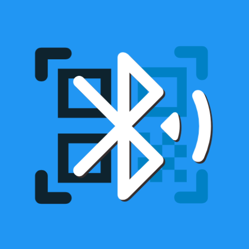
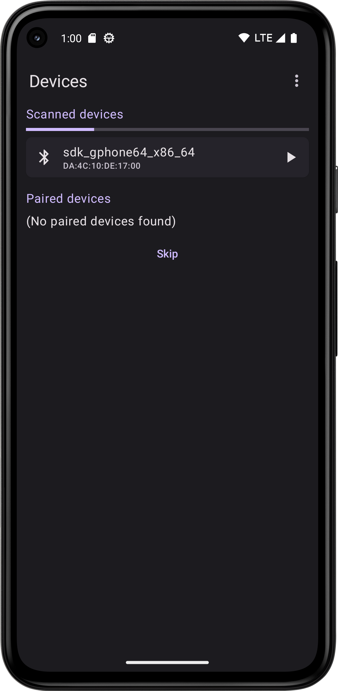
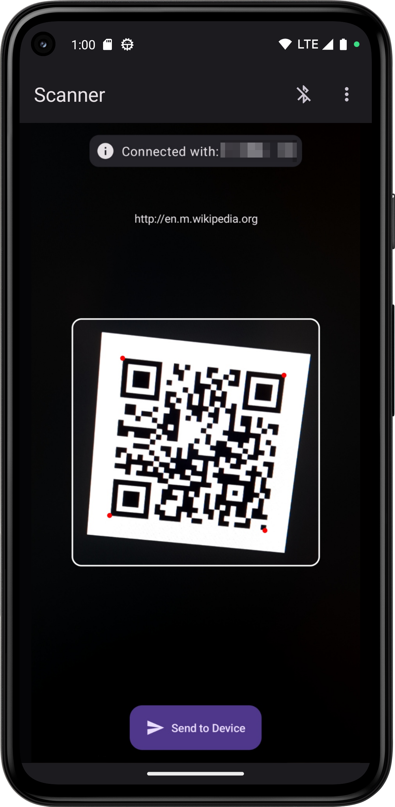
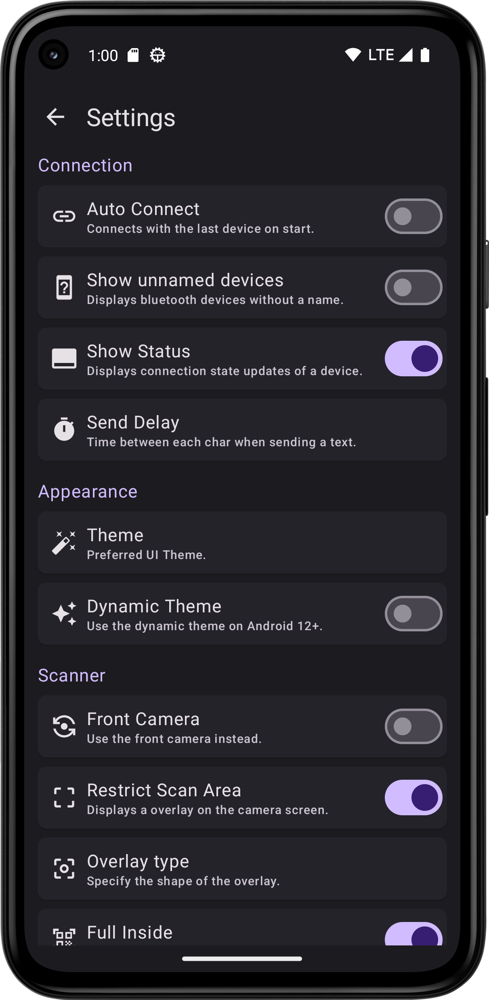
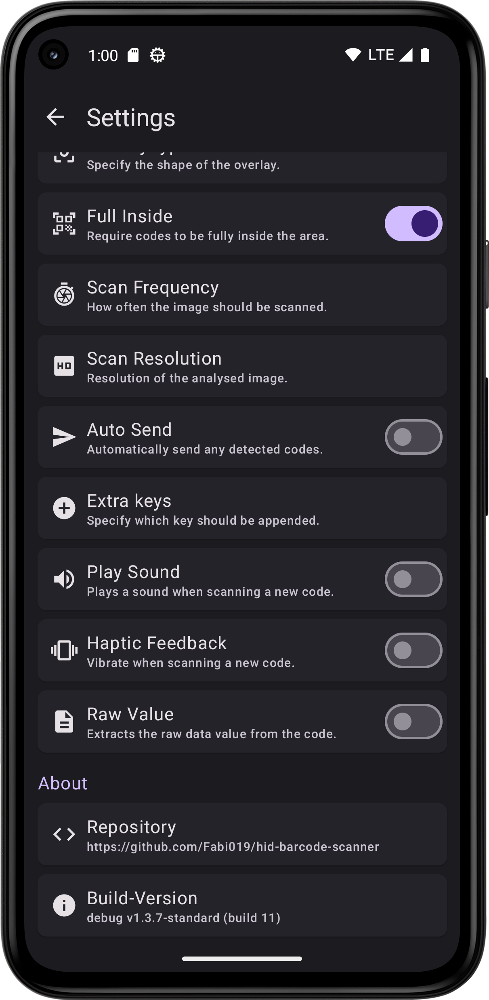

<div align="center">
  <a href="https://github.com/Umesh-Temburwar/SmartScan/actions/workflows/test.yml"></a>

  <br/>
  <br/>

  

  <h1>SmartScan — Bluetooth HID Barcode Scanner</h1>
  <p><b>Turn your Android Phone into a Wireless Bluetooth Keyboard Barcode Scanner</b></p>
  <p>Maintained by <b>Umesh Temburwar</b> (MAULI AUTOMOBILE)</p>
</div>


Android application for scanning 1D/2D barcodes with your phone camera and instantly sending them to your Windows PC over Bluetooth. **No receiver or server software is required on the PC** as the phone directly emulates a standard wireless Bluetooth HID Keyboard!

Works natively in **Notepad**, **Microsoft Excel**, **TallyPrime**, **Google Chrome**, and any desktop accounting or billing software.

## Features

- **Zero PC Software**: Emulates a real Bluetooth hardware keyboard (`BluetoothHidDevice` API on Android 9+).
- **Universal PC Compatibility**: Injects keystrokes directly into whichever Windows application has focus.
- **High-Speed Optical Scanning**: Powered by [zxing-cpp](https://github.com/zxing-cpp/zxing-cpp) supporting EAN-13, UPC, Code 128, QR Code, Data Matrix, etc.
- **100% Offline**: Zero internet required; works purely via direct Bluetooth radio.
- **Configurable Suffixes**: Sends trailing Enter (`\n`) or Tab (`\t`) after each scanned code.
- **Scan History**: Local history log with export to CSV, JSON, or Plain Text.
- **Flashlight & Continuous Mode**: Built-in torch toggle and hands-free continuous scanning.
- **Multiple Keyboard Layouts**: US, UK, DE, FR, ES, and custom keymaps.

## Screenshots

   

## Download & Build

- **Automated APK Builds**: Download the ready-to-install debug APK directly from GitHub Actions:  
  [SmartScan GitHub Actions Builds](https://github.com/Umesh-Temburwar/SmartScan/actions/workflows/test.yml)
- **Setup Guide**: Read the step-by-step connection instructions in [SETUP_GUIDE.md](SETUP_GUIDE.md) or [HOW_TO_CONNECT_MOBILE_TO_PC.md](HOW_TO_CONNECT_MOBILE_TO_PC.md).

## Troubleshooting

Below you find some common issues with possible solutions.
If these don't help, feel free to open a new issue and describe your problem in detail.

### Connection dialog visible, but no connection possible

This is most likely caused because the phone was paired with the PC previously and now doesn't
accept a new type of connection request.

***Solution:***

1. Make sure to first unpair the PC on the phone either from within the app or from the system
   Bluetooth settings
2. Remove the phone from the PC device list.
   On Windows you can either do this through the device manager (look under the Bluetooth category)
   and choose *Uninstall Device* or using the device list in the settings app.
3. In the app now search for new devices and click on the target PC (This step could be important so
   that the phone can tell the PC the new device type)
4. A pairing request should show up and you may need to confirm a pin on both sides
5. After that the connection should be successfully established

### Nothing happens when clicking on a device

If there is not even a connection dialog when clicking on a device. This means that the registered
Bluetooth proxy was interrupted. Normally it should be connected again right away but in some cases
this might not happen.

***Solution:***

Restart the app. When launching again, there should be a small message at the bottom of the screen
that says the Bluetooth proxy was successfully connected. Otherwise you may have to toggle bluetooth
or restart your device. This could also mean that your device does not support the Bluetooth HID profile.
To test this, search for the app "Bluetooth HID Profile Tester" in the PlayStore and see what the result is.
If the test is not successful, unfortunately your device is not supported.

### QR/Barcode not detected

Can be caused by very dense codes and/or not optimal lightning conditions.

***Solutions:***

- Increase the scan resolution to FHD or QHD
- Set scan frequency to Fast/Fastest
- Enable "Preview performance mode" (if supported by the camera)
- Use phone torch or external lightning if scene is too dark
- In "Advanced options":
  - Enable "Try harder" (enabled by default as of v2.2.1)
  - Enable "Try denoise" (only available since v2.2.1)
  - If you are scanning barcodes that are rotated by +-90°, enable "Try rotate image"
  - If you are scanning inverted QR/barcodes, enable "Try inverted"
  - Reduce "Minimum scan-lines"
  - Try out different binarizers

### Stuck key/Lost keys after transmission

Can happen due to connection instabilities.
If the last key release packet was lost, this will cause the key to endlessly repeat on the PC 

***Solution:***

Toggling Bluetooth on the PC or sending a new key using the manual input should reset the stuck key.

To reduce the chance of happening in the future: Increase the "Transmit delay" (>20ms). 
Otherwise you could try to tweak the L2CAP QoS settings in the top right menu of the settings.
Increasing the token rate/peak bandwith or decreasing the latency might help.

### Error: JSEngine not initialized or unsupported

The engine for running JavaScript is provided by the system WebView.
Normally this should be pre-installed as "Android System WebView".
In case this is missing, you will get the above error. On a rooted device you might be able
to install an alternative WebView for example [cromite](https://github.com/uazo/cromite).
Installation guide: https://github.com/bromite/bromite/wiki/Installing-SystemWebView

## Contributing

Contributions are what make the open source community such an amazing place to learn, inspire, and create. Any contributions you make are **greatly appreciated**.

If you have a suggestion that would make this better, please fork the repo and create a pull request. You can also simply open a new issue with the tag "enhancement".

1. Fork the Project
2. Clone/Open the Repository in Android Studio
3. Create your Feature Branch (`git checkout -b feature/AmazingFeature`)
4. Commit your Changes (`git commit -m 'Add some AmazingFeature'`)
5. Push to the Branch (`git push origin feature/AmazingFeature`)
6. Open a Pull Request

### Adding new translation

To add a new supported language first create a new folder `values-<language code>` in [app/src/main/res](app/src/main/res). 
A list of all supported language codes can be found here: <https://android.googlesource.com/platform/frameworks/base/+/main/core/res/res/values/locale_config.xml>.

Next you can copy the English [`strings.xml`](app/src/main/res/values/strings.xml) file into the newly created folder.
Using this as a base you can now translate each individual `string`/`string-array` into the target language.
Not every item needs to be translated. When a translation does not exist, Android automatically falls back to the English translation.
Only array elements either need to be fully translated or removed as a whole.

### Adding new keyboard layout

When the app sends a code to the connected device it doesn't send characters directly.
Instead the app works by sending raw HID-codes to the connected device (The same way a USB-keyboard
behaves).
It is then up to the connected device to interpret this HID-code depending on the layout that is
currently selected in the OS.
This means, that if a scanned barcode contains the character 'Z', the app needs to know the keyboard
layout that the host PC expects (QWERTZ/QWERTY) to send the right HID-code that result in that
character.
To solve this the layout in the app must match the selected layout in the PC.

The app already implements a basic set of keyboard layouts to choose from.
If you want to add a new keyboard layout the following steps might help you:

1. The first step is to create the actual keyboard layout file, for this a great guide already
   exists in the layout for the [polish keyboard](app/src/main/assets/keymaps/pl.layout).
   The layout file always consists of a list of characters with the hid code and modifier.
   Alternatively you can also use the latest Python script
   from [#438](https://github.com/Fabi019/hid-barcode-scanner/issues/438)
   to automatically generate the layout based on the data from <https://kbdlayout.info>
2. Add the name of the layout to the `<string-array name="keyboard_layout_values">` for every
   available language under `app/src/main/res/values-*/strings.xml`
3. Extend the `KeyboardLayout` enum
   in [PreferenceStore.kt](https://github.com/Fabi019/hid-barcode-scanner/blob/f62141654e3204b9e2e3ca1aee63a4822f51361a/app/src/main/java/dev/fabik/bluetoothhid/utils/PreferenceStore.kt#L46).
   The placement of the entry should match the positions in `keyboard_layout_values` and the value is the name of
   the layout file without extension (usually two letters)

## Connection Modes

The app supports three connection modes: **HID** (default), **RFCOMM** (Serial Port Profile) and
output to external plugins.
While HID mode works immediately by emulating a keyboard, RFCOMM mode requires additional setup and
may need software on your PC to receive data.

### Setting up RFCOMM mode

1. **Enable RFCOMM mode:**
   - Open the app settings
   - Change "Connection Mode" from "HID Keyboard" to "RFCOMM (SPP)"

2. **Pair your devices:**
   - Unpair your phone from PC (both sides) if previously connected
   - Remove phone from PC Bluetooth device list
   - In the app, search for devices and connect to your PC
   - Confirm pairing on both devices

3. **Verify COM port creation:**
   - On Windows: Go to Device Manager → Ports (COM & LPT)
   - You should see "Standard Serial over Bluetooth link" with a COM port number
   - If not visible, try unpairing and re-pairing using the app

4. **Receiving data on PC:**
   - **Option A:** Use terminal software (PuTTY, RealTerm, Arduino IDE Serial Monitor)
   - **Option B:** Write custom software to read from the COM port
   - **Option C:** Use PowerShell: `[System.IO.Ports.SerialPort]::GetPortNames()` to list ports

### Troubleshooting RFCOMM

**No COM port appears:**
- Unpair devices completely and re-pair using the app (not Windows settings)
- Ensure "RFCOMM (SPP)" mode is selected before pairing
- **Manual COM port management:** If automatic port creation fails:
  1. Go to Windows Bluetooth settings → More Bluetooth options → COM Ports tab
  2. Click "Add" → Select "Outgoing" port type
  3. Choose your phone from device list → Select "Barcode Scanner" service
  4. Click OK to create the COM port

**Technical details:**
- **Protocol:** Bluetooth SPP (Serial Port Profile)
- **UUID:** `00001101-0000-1000-8000-00805F9B34FB`
- **Data encoding:** UTF-8
- **Connection:** Bidirectional (app can send and receive data)
- **Baud rate:** Not applicable (Bluetooth protocol handles data transfer)

**For developers:**
Sample Python code to read from RFCOMM:
```python
import serial
port = serial.Serial('COM3')  # Baud rate not needed for Bluetooth SPP
while True:
    data = port.readline().decode('utf-8').strip()
    print(f"Received: {data}")
```

Sample C# code using System.IO.Ports:
```csharp
using System.IO.Ports;

SerialPort port = new SerialPort("COM3");
port.Open();
while (true) {
    string data = port.ReadLine();
    Console.WriteLine($"Received: {data}");
}
```

**Recommended for C# developers:** [InTheHand.Net.Bluetooth](https://github.com/inthehand/32feet) library provides better Bluetooth support that allows You more robust connection handling compared to System.IO.Ports.

## External plugins

The app also supports sending the scanned value directly to all installed and enabled plugins.
These can then be used to implement custom transmission protocols to send the codes for example over
HTTP to a PC in the same network.

### List of known plugins

- [Minimal example Plugin](https://github.com/Fabi019/bt-scanner-example-plugin) can be used as a starting point
- [TCP Transport Plugin](https://github.com/WinLin97/hid-barcode-scanner-plugin-tcp) by WinLin97

*If you want your plugin added to this list just let me know*

### Create a new plugin

Each plugin lives in a separate app. Following is an example manifest file that can be used as a
starting point:

```xml
<?xml version="1.0" encoding="utf-8"?>
<application xmlns:android="http://schemas.android.com/apk/res/android">
    <!-- Required permission for the plugin to be detected and receive scans -->
    <uses-permission android:name="dev.fabik.bluetoothhid.permission.RECEIVE_SCANS" />
    <!-- Required to send plugin results back -->
    <queries>
        <package android:name="dev.fabik.bluetoothhid" />
    </queries>

    <application>
        <activity>
            <!-- Optional: Settings entry-point opened on long-press in the plugin picker -->
            <intent-filter>
                <action android:name="dev.fabik.bluetoothhid.plugin.action.SETTINGS" />
                <category android:name="android.intent.category.DEFAULT" />
            </intent-filter>
        </activity>

        <!-- Receives scans. Metadata is shown in the plugin picker. -->
        <receiver android:name=".ScanReceiver" android:exported="true"
            android:permission="dev.fabik.bluetoothhid.permission.RECEIVE_SCANS">
            <intent-filter>
                <action android:name="dev.fabik.bluetoothhid.action.BARCODE_SCANNED" />
            </intent-filter>
            <meta-data android:name="dev.fabik.bluetoothhid.plugin.label"
                android:value="Example Plugin" />
            <meta-data android:name="dev.fabik.bluetoothhid.plugin.shortLabel"
                android:value="Example" />
            <meta-data android:name="dev.fabik.bluetoothhid.plugin.author"
                android:value="The author" />
        </receiver>

        <!-- Lifecycle + health channel from the core (warm up / release / liveness ping). -->
        <receiver android:name=".PluginControlReceiver" android:exported="true"
            android:permission="dev.fabik.bluetoothhid.permission.RECEIVE_SCANS">
            <intent-filter>
                <action android:name="dev.fabik.bluetoothhid.plugin.action.SET_ENABLED" />
                <action android:name="dev.fabik.bluetoothhid.plugin.action.PING" />
            </intent-filter>
        </receiver>
    </application>
</manifest>
```

When the app receives an `BARCODE_SCANNED` broadcast, the following data is transmitted as `Extra`
inside the intent.
(All definitions of the various fields can be found in the
file [ExternalProtocol.kt](https://github.com/Fabi019/hid-barcode-scanner/blob/main/app/src/main/java/dev/fabik/bluetoothhid/bt/ExternalProtocol.kt))

- Protocol version
- Scan id for responding to a scan
- Raw value & Processed value
- Format
- Timestamp
- Source and Scanner ID
- Regex groups
- Scan image name

The external plugin must also react to any `action.PING` requests from the app by responding with an
intent for example
with the following content:

```kotlin
val intent = Intent("dev.fabik.bluetoothhid.plugin.action.STATUS").apply {
    setPackage("dev.fabik.bluetoothhid")
    putExtra("protocol_version", 1)
    putExtra("package", ctx.packageName)
    putExtra("running", true)
    // Supported states: IDLE, STARTING, CONNECTING, CONNECTED, LISTENING, ERROR, BLOCKED, NO_PERMISSION, UNKNOWN
    putExtra("state", "IDLE")
    putExtra("status_detail", "Example plugin connected")
}
ctx.sendBroadcast(intent)
```

## Author & Maintainer

- **Developer**: **Umesh Temburwar**
- **Organization / Business**: **MAULI AUTOMOBILE**
- **Repository**: [https://github.com/Umesh-Temburwar/SmartScan](https://github.com/Umesh-Temburwar/SmartScan)

## License

Copyright (C) 2026 Umesh Temburwar / MAULI AUTOMOBILE  
Based on BluetoothHID: Copyright (C) 2023-2026 Fabi019

    This program is free software: you can redistribute it and/or modify
    it under the terms of the GNU General Public License as published by
    the Free Software Foundation, either version 3 of the License, or
    (at your option) any later version.

    This program is distributed in the hope that it will be useful,
    but WITHOUT ANY WARRANTY; without even the implied warranty of
    MERCHANTABILITY or FITNESS FOR A PARTICULAR PURPOSE.  See the
    GNU General Public License for more details.
