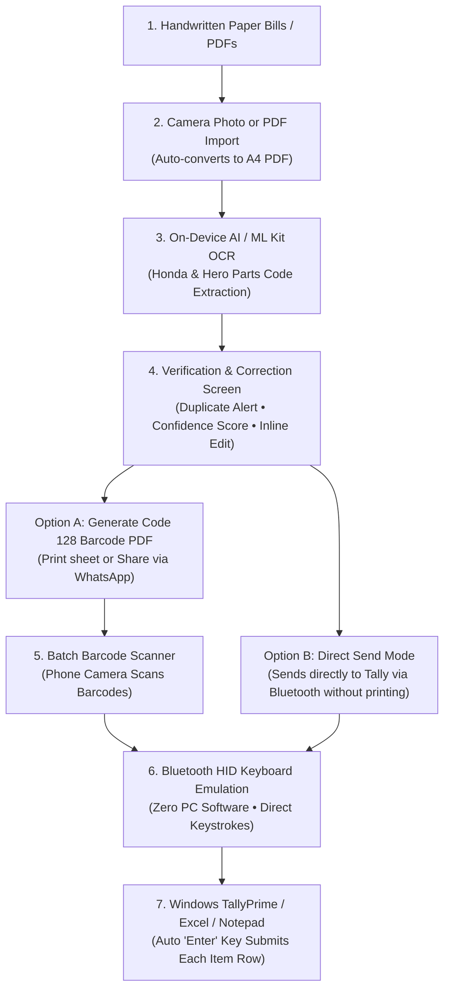

# MAULI BARCODE (मौली बारकोड)
### AI Handwritten Barcode to TallyPrime Android App & Wireless Bluetooth HID Scanner

<div align="center">
  

  <h2>MAULI AUTOMOBILES (मौली ऑटोमोबाईल्स)</h2>
  <p><b>Honda & Hero Genuine 2-Wheelers Spares (Wholesale & Retail)</b></p>
  <p>Raje Shivchhatrapati N.P. Complex, Mondha Road, Ambajogai, Maharashtra 431517 | Contact: <b>098232 91444</b></p>
  <p>Architect & Developer: <b>Umesh Temburwar</b> | Official Repository: <a href="https://github.com/Umesh-Temburwar/Mauli-Automobiles-"><b>Umesh-Temburwar/Mauli-Automobiles-</b></a></p>
</div>

---

## 📌 Overview

**MAULI BARCODE** is a native Android application built specifically for automobile spare parts retail and wholesale counters. It eliminates the manual, time-consuming nightly entry of handwritten customer bills into **TallyPrime** and other accounting software.

During the busy counter hours, shopkeepers jot down part codes, barcode numbers, and quantities by hand on paper bill pads. At night, manually re-typing 100+ part numbers into Tally is slow and causes costly billing errors.

**MAULI BARCODE** solves this with a 100% automated, offline-first pipeline:
1. **Snap a photo or upload bill PDFs** right from the shop counter.
2. **On-device AI / ML Kit OCR** extracts handwritten numbers and OEM spare parts codes (including Hero/Honda codes with hyphens, e.g. `17211-KUD-900`).
3. **Verify and correct** numbers with confidence alerts, duplicate detection, and leading-zero preservation.
4. **Generate Code 128 barcode sheets** (A4 PDF) to print, or use **Direct Send Mode**.
5. **Zero PC Software Required**: The phone pairs directly with your Windows PC as a standard **wireless Bluetooth HID keyboard**, automatically injecting keystrokes followed by `Enter` into TallyPrime!

---

## 🔄 End-to-End Workflow



---

## ✨ Key Features

* **📷 Camera Bill Photo Capture & Gallery Picker**:
  Take a clear picture of any paper bill pad directly inside the app, or select photos received on WhatsApp. The app automatically converts and scales them into high-contrast A4 PDF pages for OCR.
* **🧠 AI Handwritten Barcode & OEM Part OCR**:
  Powered by Google ML Kit on-device Text Recognition with adaptive image binarization and contrast enhancement. Specially tuned for Indian handwriting (`O/0`, `I/1`, `S/5`, `B/8` normalization) and multi-part codes with hyphens (`17211-KUD-900`, `22102-KWP-D00`, etc.).
* **✅ Multi-Batch Verification Screen**:
  Review extracted codes per bill. Displays verification status (*Verified*, *Needs Review*, *Duplicate*). Add manual codes, edit inline, approve all with one tap, and switch between bills using the top Batch Selector.
* **🖨️ Printable Code 128 Barcode Sheet Generator**:
  Generates crisp A4 2-column printable PDF sheets containing scannable Code 128 barcodes, shop branding, bill numbers, and human-readable text. Share instantly via WhatsApp or print via Google Cloud Print/WiFi printer.
* **⌨️ Zero PC Software Bluetooth HID Emulation**:
  No server, receiver, or driver required on Windows. Your Android phone presents itself as a standard wireless Bluetooth hardware keyboard (`BluetoothHidDevice` API on Android 9+).
* **⚡ Direct Send to Tally (No-Print Mode)**:
  Skip printing altogether! Verified numbers are automatically typed one-by-one into Windows TallyPrime over Bluetooth with customizable delay and automatic `Enter` key suffix.
* **📦 Batch Barcode Scanner**:
  Scan printed sheets rapidly with the phone camera. Live progress counters (Total, Scanned, Pending, Duplicates) with sound and haptic feedback.
* **💾 100% Offline SQLite Local Database**:
  All bills, batches, barcode records, and scan history are safely stored offline in the device SQLite database. Never loses your data without network.
* **📊 Export Reports**:
  Export scan batches and history to CSV, plain text, or share directly via WhatsApp, Email, or Google Drive.
* **🔄 In-App Auto-Updates**:
  Built-in version checker and update downloader allowing in-place seamless updates.

---

## 📱 Application Screens

| Screen | Purpose |
|---|---|
| **Dashboard** | Modern Material 3 dashboard with large shopkeeper-friendly action buttons. |
| **PDF & Photo Import** | Capture bill photos with camera, pick gallery pictures, or import multi-page PDFs. |
| **Verification & OCR** | Review, edit, approve handwritten numbers, filter duplicates, and manage batches. |
| **Generate Barcode PDF** | Generate Code 128 printable A4 barcode sheets with direct WhatsApp/Drive share. |
| **Batch Scanner** | Continuous rapid camera scanner with Tally `Enter`/`Tab` suffix and progress tracker. |
| **Bluetooth Devices** | Pair and connect with your Windows PC in 1 tap. |
| **Direct Send to Tally** | Automated sequential keyboard typing into TallyPrime without printing. |
| **Scan History & Reports** | Detailed audit log with CSV and WhatsApp export. |
| **Settings & Layouts** | Keyboard layouts (US, UK, DE, FR), transmission delays, and scanner QOS. |

---

## 🛠️ How to Open, Build & Run in Android Studio

Follow these exact steps to build and install the APK yourself:

### Prerequisites
* **Android Studio**: Android Studio Ladybug / Iguana / Jellyfish (latest version).
* **JDK**: Java 17 (bundled JetBrains Runtime `jbr-17` inside Android Studio).
* **Android SDK**: SDK Platform 35 (Android 15), build-tools 35.0.0.

### Step-by-Step Build Instructions

1. **Clone the Repository**:
   ```bash
   git clone https://github.com/Umesh-Temburwar/Mauli-Automobiles-.git
   ```

2. **Open in Android Studio**:
   * Open Android Studio, click **File** -> **Open**.
   * Navigate to the cloned folder: `.../Mauli-Automobiles-/` and click **OK**.

3. **Wait for Gradle Sync to Complete**:
   > ⚠️ **Important**: When first opened, Android Studio will show **"Importing 'hid-barcode-scanner' Gradle Project"** at the bottom status bar.
   > While Gradle is syncing, the `Build APK` and `Play` buttons remain temporarily disabled. Please wait 1–2 minutes until sync completes.

4. **Verify Gradle JDK (if prompted)**:
   * Go to **Settings** (or **Preferences** on macOS) -> **Build, Execution, Deployment** -> **Build Tools** -> **Gradle**.
   * Under **Gradle JDK**, ensure it is set to **Embedded JDK / jbr-17**.

5. **Generate the APK**:
   * From the top menu, click **Build** -> **Build Bundle(s) / APK(s)** -> **Build APK(s)**.
   * Android Studio will compile the app and show a popup at the bottom right:
     `APK(s) generated successfully for module 'app' with 1 build variant: Locate`.
   * Click **Locate** to open the folder containing the `.apk`.

6. **Direct Terminal Build (Quick Alternative)**:
   You can also build the APK directly from PowerShell / Command Prompt without Android Studio:
   ```powershell
   $env:JAVA_HOME="C:\Program Files\Android\Android Studio\jbr"
   .\gradlew assembleDebug
   ```
   The APK will be generated at:
   `app\build\outputs\apk\debug\app-universal-debug.apk`

---

## 💻 How to Connect Phone to Windows PC via Bluetooth

No software or drivers are required on your Windows PC!

1. **Turn ON Windows Bluetooth**:
   * On your PC, press `Win + I` to open **Settings**.
   * Go to **Bluetooth & devices** and ensure Bluetooth is toggled **ON**.
   * Click **Add device** -> **Bluetooth**.

2. **Pair with Android Phone**:
   * Open the **MAULI BARCODE** app on your Android phone.
   * Tap **Bluetooth Connect to Tally** from the Dashboard.
   * Tap on your **PC Name** from the available Bluetooth devices list.
   * Confirm the matching 6-digit PIN on both your phone and PC.
   * Windows will notify: *"Your Bluetooth keyboard device is ready to go!"*.

---

## 🧾 How to Use with TallyPrime

1. Connect your phone to your PC via Bluetooth (as described above).
2. Open **TallyPrime** on your Windows computer.
3. Navigate to **Gateway of Tally** -> **Vouchers** -> Press `F8` for **Sales Voucher**.
4. In the **Name of Item** column, click into the first item field so the cursor is blinking.
5. In the **MAULI BARCODE** app on your phone:
   * **Via Batch Scanner**: Point the camera at your printed barcode sheet. As each barcode is scanned, the part number is typed into Tally and `Enter` is automatically pressed to confirm the item!
   * **Via Direct Send**: Select your bill batch, tap **Start Direct Send**. The app types all verified part codes sequentially into Tally with automatic `Enter` keystrokes.

---

## 📂 Project Structure

```
hid-barcode-scanner/
├── app/
│   ├── src/main/java/dev/fabik/bluetoothhid/
│   │   ├── bt/                     # Bluetooth HID & RFCOMM keyboard protocol implementation
│   │   ├── data/                   # SQLite database (MauliDatabase.kt, Models.kt, ExportManager.kt)
│   │   ├── generator/              # Barcode generator (ZXing Code 128) & A4 PDF Generator
│   │   ├── ocr/                    # Google ML Kit OCR provider & Gemini Vision provider
│   │   ├── pdf/                    # SAF PDF importer, camera photo & gallery A4 converter
│   │   ├── ui/screens/             # Material 3 UI screens
│   │   │   ├── DashboardScreen.kt     # Main app dashboard
│   │   │   ├── PdfImportScreen.kt     # Camera / Gallery / PDF import screen
│   │   │   ├── VerificationScreen.kt  # Bill OCR review & multi-batch editor
│   │   │   ├── BarcodePdfScreen.kt    # Code 128 PDF generator & WhatsApp share
│   │   │   ├── BatchScannerScreen.kt  # Camera barcode batch scanner with Tally suffix
│   │   │   ├── DirectSendScreen.kt    # Direct-to-Tally Bluetooth keyboard sender
│   │   │   └── ReportsScreen.kt       # Export CSV and share reports
│   │   └── utils/                  # CameraX analyzer, update manager, preferences
├── docs/                           # Documentation and guides
├── website/                        # Official Mauli Automobiles website
├── build.gradle                    # Top-level Gradle configuration
├── settings.gradle                 # Project modules definition
└── README.md                       # Main documentation
```

---

## 👨‍💻 Author & Maintainer

* **Developer & Architect**: **Umesh Temburwar**
* **Business / Shop**: **MAULI AUTOMOBILES (मौली ऑटोमोबाईल्स)**
* **Address**: Raje Shivchhatrapati N.P. Complex, Mondha Road, Ambajogai, Maharashtra 431517
* **Contact**: **+91 98232 91444**
* **Official GitHub Repository**: [https://github.com/Umesh-Temburwar/Mauli-Automobiles-](https://github.com/Umesh-Temburwar/Mauli-Automobiles-)

---

## 📄 License

Copyright (C) 2026 **Umesh Temburwar / MAULI AUTOMOBILE**  
Based on BluetoothHID: Copyright (C) 2023–2026 Fabi019

Licensed under the **GNU General Public License v3.0 (GPLv3)**. See [LICENSE](LICENSE) for full details.
