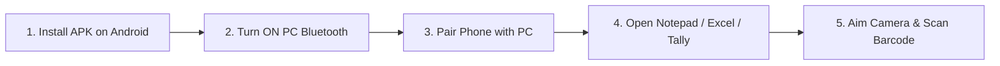

# HID Barcode Scanner — Complete Mobile to PC Bluetooth Setup Guide

Turn your Android smartphone into a **physical wireless Bluetooth barcode scanner** for your Windows PC!

> **Why this is better than other barcode apps:**
> - **Zero PC Software Required**: You do **not** need to install or run any software on your Windows PC.
> - **Acts as a Real Bluetooth Keyboard**: Your Android phone uses Android's native `BluetoothHidDevice` API to emulate a standard hardware wireless Bluetooth keyboard.
> - **Universal Windows Compatibility**: Works natively in **Notepad**, **Microsoft Excel**, **TallyPrime**, **Google Chrome**, **Word**, and **all billing/inventory desktop software**.
> - **100% Offline**: Operates directly over Bluetooth without Wi-Fi, internet, routers, or firewall ports.

---

## 1. Quick Step-by-Step Connection Workflow

---

## 2. Step 1: Install the Android App

1. Go to your GitHub repository Actions:
   [https://github.com/Umesh-Temburwar/SmartScan/actions](https://github.com/Umesh-Temburwar/SmartScan/actions)
2. Click on the latest workflow run and download the **APK(s) debug generated** artifact.
3. Transfer or open the `.apk` file on your Android device (Android 9.0 or higher required).
4. Tap **Install** (if prompted, allow installation from unknown sources).
5. Launch the **HID Barcode Scanner** app.
6. Grant the requested permissions:
   - **Camera**: Required to read barcodes using the camera.
   - **Nearby Devices / Bluetooth**: Required to pair with your PC.

---

## 3. Step 2: Pair Your Phone to Your Windows PC

1. **On your Windows PC**:
   - Open **Settings** (press `Win + I`).
   - Click on **Bluetooth & devices**.
   - Make sure Bluetooth is toggled **ON**.
   - Click **Add device** > **Bluetooth**.
2. **On your Android Phone**:
   - In the HID Barcode Scanner app, you will see a list of available/paired Bluetooth devices.
   - If your PC is not listed, tap **Scan for devices**.
   - Tap on your **PC Name** from the list.
   - Tap **Pair** when the Bluetooth pairing prompt appears on both your phone and PC.
3. Windows will notify you:
   > *"Bluetooth HID Device is connected and ready to use."*
4. In the app, your PC will now display a green **Connected** status indicator!

---

## 4. Step 3: Scan Barcodes into Notepad, Excel, or TallyPrime

1. **Open your target application on Windows**:
   - **Notepad**: Open a new text document and click inside.
   - **Microsoft Excel**: Click on the cell where you want to enter the barcode.
   - **TallyPrime**: Navigate to Item Master or Voucher Entry where item alias is entered.
   - **Billing / POS Software**: Focus on the barcode input field.
2. **Scan on your phone**:
   - Open the **Scanner** tab in the app.
   - Point your phone camera at any 1D or 2D barcode (EAN-13, UPC, Code 128, QR Code).
   - As soon as the camera sees the barcode:
     - The phone beeps/vibrates.
     - The barcode characters are sent over Bluetooth as keyboard strokes.
     - The barcode types directly into your PC cursor position!

---

## 5. Recommended Settings

In the app, tap the **Settings** icon to customize:

| Setting | Recommended Value | Purpose |
| :--- | :--- | :--- |
| **Extra Key (Suffix)** | `\n (Enter)` | Automatically presses Enter after each scan (moves to next line in Notepad, next row in Excel, confirms item in TallyPrime). |
| **Alternative Suffix** | `\t (Tab)` | Automatically moves to the next column in Excel or next field in billing software. |
| **Continuous Scanning** | `Enabled` | Scan multiple items in rapid succession without tapping the screen. |
| **Keyboard Layout** | `US (Default)` | Matches your Windows keyboard layout so keys type correctly. |
| **Flashlight / Torch** | As needed | Toggle on to scan items on dark stockroom shelves. |
| **Scan History** | `Enabled` | Saves a log of all scanned barcodes with export to CSV/JSON. |

---

## 6. Troubleshooting

- **Windows says "Driver error" or doesn't type**:
  - Unpair the phone from Windows Settings > Bluetooth > Remove device.
  - In phone Bluetooth settings, unpair the PC.
  - Restart phone Bluetooth, then pair again from the HID Barcode Scanner app.
- **My phone says "Bluetooth HID not supported"**:
  - The Android device must run Android 9 (Pie) or higher.
  - A small number of older custom Android ROMs disable `BluetoothHidDevice` in firmware. Use any standard Android 9+ device.
- **Barcodes type with wrong characters**:
  - In App Settings > **Keyboard Layout**, select the layout that matches your Windows keyboard language (US layout is standard for English).
