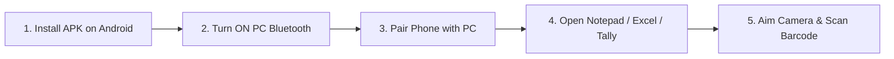

# Mauli Automobiles — Mobile to PC Barcode Scanner Setup Guide

Turn your Android smartphone into a **wireless Bluetooth barcode scanner** for **Mauli Automobiles** counter billing and inventory management!

### Shop Details
* **Shop**: **Mauli Automobiles** (मौली ऑटोमोबाईल्स)
* **Specialization**: Honda & Hero Genuine 2-Wheelers Spares (Wholesale & Retail)
* **Address**: Raje Shivchhatrapati N.P. Complex, Mondha Road, Ambajogai, Maharashtra 431517
* **Contact**: 098232 91444
* **Maintainer**: **Umesh Temburwar**
* **Repository**: [https://github.com/Umesh-Temburwar/Mauli-Automobiles-](https://github.com/Umesh-Temburwar/Mauli-Automobiles-)

> **Why this is better than other barcode apps:**
> - **Zero PC Software Required**: You do **not** need to install or run any software on your Windows PC.
> - **Acts as a Real Bluetooth Keyboard**: Your Android phone uses Android's native `BluetoothHidDevice` API to emulate a standard hardware wireless Bluetooth keyboard.
> - **Universal Windows Compatibility**: Works natively in **Notepad**, **Microsoft Excel**, **TallyPrime**, **Google Chrome**, **Word**, and **all billing/inventory desktop software**.
> - **100% Offline**: Operates directly over Bluetooth without Wi-Fi, internet, routers, or firewall ports.

---

## 1. Quick Step-by-Step Connection Workflow

---

## 2. Step 1: Install the Android App

1. Download the latest APK from the repository:
   [https://github.com/Umesh-Temburwar/Mauli-Automobiles-](https://github.com/Umesh-Temburwar/Mauli-Automobiles-)
2. Transfer or open the `.apk` file on your Android device (Android 9.0 or higher required).
3. Tap **Install** (if prompted, allow installation from unknown sources).
4. Launch the **MAULI BARCODE** app.
5. Grant the requested permissions:
   - **Camera**: Required to read barcodes and snap bill photos using the camera.
   - **Nearby Devices / Bluetooth**: Required to pair with your PC.

---

## 3. Step 2: Pair Your Phone to Your Windows PC

1. **On your Windows PC**:
   - Open **Settings** (press `Win + I`).
   - Click on **Bluetooth & devices**.
   - Make sure Bluetooth is toggled **ON**.
   - Click **Add device** > **Bluetooth**.

2. **On your Phone**:
   - In **MAULI BARCODE**, tap **Bluetooth Connect to Tally** (or the Devices tab).
   - Find your PC in the list and tap on it.
   - A 6-digit PIN popup will appear on both your phone and PC screen.
   - Confirm that the numbers match, and tap **Pair** on both.
   - Windows will display: *"Your device is ready to go!"*.

---

## 4. Step 3: Test Direct Typing into PC

1. On your PC, open **Notepad** (`Win + R`, type `notepad`, press Enter).
2. Click inside Notepad so the cursor is blinking.
3. On your phone, tap **Batch Barcode Scanner** or open the scanner view.
4. Point your camera at any barcode (e.g. on a spare part box or printed bill sheet).
5. **The code instantly types into Notepad and presses Enter!**

---

## 5. Step 4: Use with TallyPrime

1. Open **TallyPrime** on Windows.
2. Go to **Gateway of Tally** -> **Vouchers** -> Press `F8` for Sales.
3. Click in the **Name of Item** or **Part Number** column.
4. Scan the barcode or use **Direct Send to Tally** in the app.
5. The exact part code is typed in, `Enter` is triggered, and your sales voucher moves to the quantity column!
